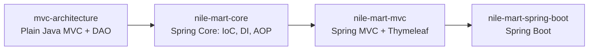
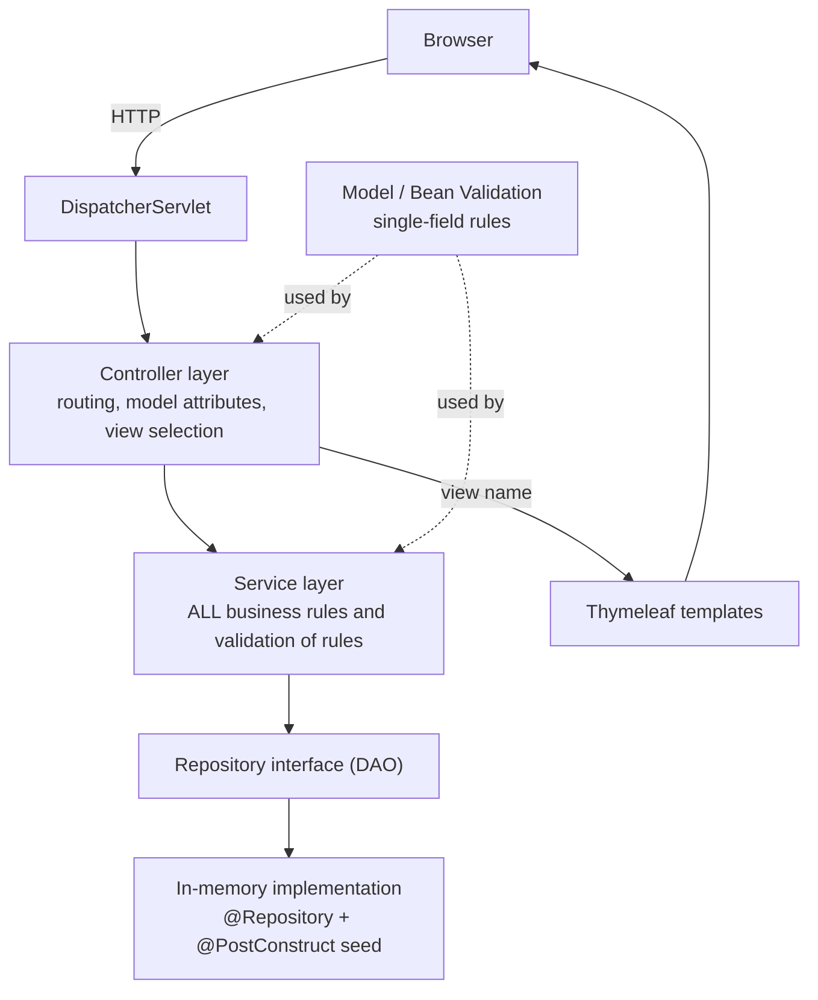
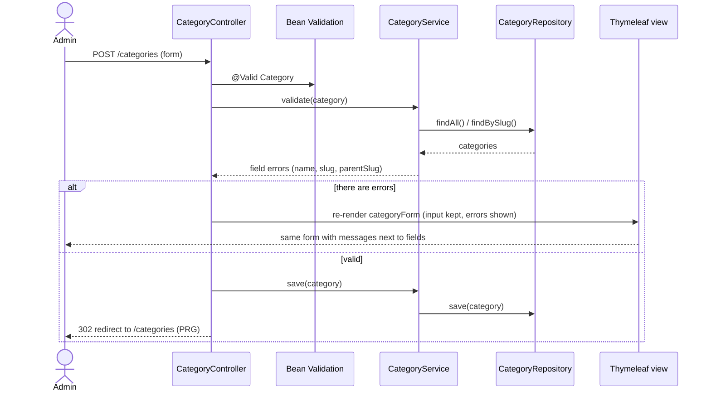
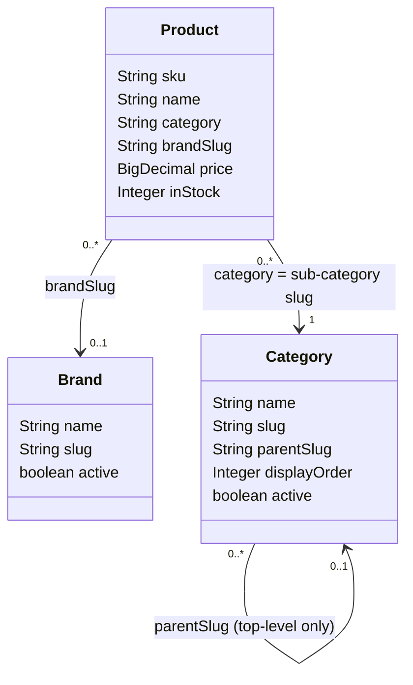

# NileMart

> A progressive, hands-on e-commerce back-office project that takes the same domain (products, brands, categories) from **plain Java MVC**, through **Spring Core (IoC, AOP)** and **Spring MVC + Thymeleaf**, to **Spring Boot**.


---

## Table of contents

1. [Overview](#1-overview)
2. [Repository layout](#2-repository-layout)
3. [Architecture](#3-architecture)
4. [Domain model and business rules](#4-domain-model-and-business-rules)
5. [Features](#5-features)
6. [Module guide](#6-module-guide)
7. [Tech stack](#7-tech-stack)
8. [Getting started](#8-getting-started)
9. [Seed data](#9-seed-data)
10. [Manual test checklist](#10-manual-test-checklist)
11. [Design decisions](#11-design-decisions)
12. [Known limitations](#12-known-limitations)
13. [Roadmap](#13-roadmap)
14. [Contributing and workflow](#14-contributing-and-workflow)

---

## 1. Overview

NileMart is a learning-oriented but production-minded code base. The same small domain is rebuilt in four modules, each one introducing the next layer of the Java and Spring ecosystem, so you can compare how the **same responsibilities** are wired by hand, by the Spring container, by Spring MVC, and finally by Spring Boot.

The main deliverable is the **`nile-mart-mvc`** module: a server-rendered back office with three sections.

| Section | Purpose |
|---|---|
| **Products** | Catalogue of sellable items, linked to a sub-category and an optional brand |
| **Categories** | A strict two-level tree (top-level category, then sub-category) |
| **Brands** | Companies that make products; may be active or inactive |

Core principles that apply everywhere:

- **Layered architecture** (Controller, Service, Repository, Model, View) with one-way dependencies.
- **Business rules live in services only.** Controllers orchestrate; templates only render.
- **Constructor injection only** (no field injection).
- **Repository abstraction (DAO pattern)** so storage can change without touching services.
- **Post/Redirect/Get** after every successful write (rule `ADM-03`).

---

## 2. Repository layout

The repository is a collection of **four independent Maven/Java modules** (there is no aggregator `pom.xml`; each module is built on its own).

```text
NileMart/
├── mvc-architecture/          # Step 1: plain Java console app, hand-wired MVC + DAO
├── nile-mart-core/            # Step 2: Spring Core (IoC/DI, @Configuration, AOP, properties)
├── nile-mart-mvc/             # Step 3: Spring MVC + Thymeleaf back office (WAR, no Boot)
├── nile-mart-spring-boot/     # Step 4: same ideas on Spring Boot (auto-configuration)
├── .github/CODEOWNERS
├── .gitignore
└── README.md
```



---

## 3. Architecture

### 3.1 Layered view (applies to `nile-mart-mvc` and `nile-mart-spring-boot`)



| Layer | Package | Responsibility | Must **not** |
|---|---|---|---|
| Model | `org.route.model` | Data holders (Lombok) and single-field Bean Validation | contain business rules that span records |
| Repository (DAO) | `org.route.repository` | Interface plus in-memory implementation, seed data in `@PostConstruct` | contain business rules |
| Service | `org.route.service` | All business rules: uniqueness, parent/child rules, brand/category checks, ordering, lookups | know about HTTP or views |
| Controller | `org.route.controller` | Call services, add model attributes, pick the view, redirect after save | contain business logic |
| View | `resources/templates` | Render data and errors | contain lookups or logic |
| Config | `org.route.config` | `WebAppInitializer`, `WebConfig` (Thymeleaf, MVC) | |

Dependencies point **downwards only**: Controller depends on Service, Service depends on Repository interface, never the reverse.

### 3.2 Request flow: create a category



### 3.3 Domain relationships (by slug, not by object)



References are stored as **slug strings**, so a record can be looked up by a stable, URL-friendly ID and the name can change without breaking links.

### 3.4 Module-level architecture

| Module | Wiring style | What it demonstrates |
|---|---|---|
| `mvc-architecture` | Manual `new` in `Main` | MVC and DAO without any framework |
| `nile-mart-core` | Spring container (annotations, Java config, XML) | IoC, DI, qualifiers, `@Primary`, property injection, AOP |
| `nile-mart-mvc` | `AbstractAnnotationConfigDispatcherServletInitializer` + `@EnableWebMvc` | Spring MVC without Boot, Thymeleaf, validation, PRG |
| `nile-mart-spring-boot` | Spring Boot auto-configuration | Same app with starters and `@ConfigurationProperties` |

---

## 4. Domain model and business rules

Rule IDs follow the NileMart business-rule numbering used by the assignments.

### 4.1 Glossary

| Term | Meaning |
|---|---|
| **Slug** | URL-friendly ID: lower-case letters, digits and hyphens only (`mobile-phones`). Typed by the admin, validated by the app, never generated and never changed after creation. |
| **Top-level category** | A category with an empty `parentSlug`. Groups sub-categories in the store menu. |
| **Sub-category** | A category whose `parentSlug` is an existing top-level category. Products attach only to sub-categories. |
| **Display order** | A non-negative number controlling sort order in menus and lists. Not an ID: duplicates are allowed under different parents. |
| **Active** | Inactive brands/categories are kept (history still points to them) but hidden from customers and from new choices. |

### 4.2 Rules by feature

**Brands**

| Field | Rule | Message |
|---|---|---|
| name | required, 2 to 50 chars, unique ignoring case | `Brand name already exists` |
| slug | required, pattern `[a-z0-9-]`, unique | `Slug already exists` |
| active | defaults to `true` | |

**Categories** (`CAT-01`: exactly two levels)

| Field | Rule | Message |
|---|---|---|
| name | required, 2 to 50 chars, unique **within the same parent**, ignoring case | `A category with this name already exists under Electronics` |
| slug | same pattern as brand, unique across **all** categories | `Slug already exists` |
| parentSlug | optional; when set it must exist and be top-level | field error on `parentSlug` |
| displayOrder | required, 0 or more | |
| active | defaults to `true` | |

**Products**

| Field | Rule |
|---|---|
| sku | required, unique |
| name, price, inStock | required, price greater than 0, stock 0 or more |
| category | must be an existing **sub-category** slug |
| brandSlug | optional; when set it must exist and be **active** |

---

## 5. Features

### 5.1 Brands (`/brands`)

- List all brands with name, slug and an active column (`Yes` / `No`).
- Create a brand with full validation; errors are shown next to each field with the typed values preserved.
- Inactive brands never appear in the product form.

### 5.2 Categories (`/categories`)

- Hierarchical list: each top-level category is followed by its sub-categories, both sorted by display order. Sub-categories are prefixed with `— ` and show their parent's name.
- Create form with a **Parent** drop-down: `None (top level)` plus top-level categories only.
- Enforces the two-level tree and per-parent name uniqueness.

### 5.3 Products (`/products`)

- Table of available products (stock greater than 0) showing category **name** and brand **name** (`—` when no brand).
- Product form with a sub-category drop-down and a Brand drop-down (`No brand` plus active brands).
- Server-side rejection of non-sub-categories and unknown or inactive brands.

### 5.4 Cross-cutting

- Shared top menu on every page: **Products, Categories, Brands**.
- Form errors re-render the same form (no redirect-and-lose-input).
- Post/Redirect/Get after every successful save (`ADM-03`).

### 5.5 HTTP endpoints (`nile-mart-mvc`)

| Method | Path | Description |
|---|---|---|
| GET | `/products` | Products table |
| GET | `/products/new` (alias `/new`) | Empty product form |
| POST | `/products` | Validate, save, redirect to `/products` |
| GET | `/brands` | Brands table |
| GET | `/brands/new` | Empty brand form |
| POST | `/brands` | Validate, save, redirect to `/brands` |
| GET | `/categories` | Hierarchical categories table |
| GET | `/categories/new` | Empty category form |
| POST | `/categories` | Validate, save, redirect to `/categories` |

---

## 6. Module guide

### 6.1 `mvc-architecture` (plain Java)

A console application that prints available products. Packages: `controller`, `dao`, `modal`, `service`, `view`. The `Main` class wires everything by hand (`new`), which makes the dependency graph explicit:

```text
ProductViewer + InMemoryProductDao -> ProductService -> ProductController
```

Placeholders for a future customer feature exist (`CustomerDao`, `FileCustomerDao`, `CustomerContoller`).

### 6.2 `nile-mart-core` (Spring Core)

Focuses on the container rather than the web:

| Concept | Where |
|---|---|
| Component scanning, `@Configuration`, `@PropertySource` | `AppConfig` |
| Constructor DI with `@Qualifier` | `ProductService` |
| `@Primary` strategy selection | `PromotionalPricingService` (primary) vs `StandardPricingService` |
| Externalised config with `@Value` | `store.discount-amount=10` |
| AOP (`@Around` logging of service calls) | `ExecutionLog` |
| XML configuration (alternative) | `beans.xml` |
| Manual factory (for comparison) | `ObjectFactory` |

Pricing is a small strategy pattern: `PricingService` has a standard implementation (price times quantity) and a promotional one (subtracts a percentage).

### 6.3 `nile-mart-mvc` (Spring MVC, main module)

Packaged as a **WAR** and launched with the **Jetty Maven plugin**; no Spring Boot. Key classes:

- `WebAppInitializer`: registers the `DispatcherServlet` mapped to `/`.
- `WebConfig`: `@EnableWebMvc`, component scan on `org.route`, Thymeleaf template resolver, engine and view resolver.

Target structure:

```text
nile-mart-mvc/
├── pom.xml
└── src/main
    ├── java/org/route
    │   ├── config/        WebAppInitializer, WebConfig
    │   ├── model/         Product, Brand, Category (+ small display records)
    │   ├── repository/    *Repository (interface) + InMemory*Repository
    │   ├── service/       ProductService, BrandService, CategoryService
    │   └── controller/    ProductController, BrandController, CategoryController
    └── resources/templates
        ├── fragments/menu.html
        ├── products.html, productForm.html
        ├── brands.html,   brandForm.html
        └── categories.html, categoryForm.html
```

### 6.4 `nile-mart-spring-boot` (Spring Boot)

The same products feature on Spring Boot 4 with `spring-boot-starter-thymeleaf` and `spring-boot-starter-webmvc`. Adds a type-safe `@ConfigurationProperties` class (`StoreProperties`, prefix `store`) and a VAT view at `/product/vat`. Runs on port **9090**.

---

## 7. Tech stack

| Area | Technology |
|---|---|
| Language | Java 26 (see [Getting started](#8-getting-started) if you use an earlier JDK) |
| Framework | Spring Framework 7 (MVC and Core), Spring Boot 4.1 |
| View | Thymeleaf 3.1 (`thymeleaf-spring6`) |
| Validation | Jakarta Bean Validation, Hibernate Validator 8 |
| Boilerplate | Lombok |
| Server | Jetty 12 (Maven plugin) for `nile-mart-mvc`; embedded server for Boot |
| Build | Maven |
| Persistence | None: in-memory repositories |

---

## 8. Getting started

### Prerequisites

- **JDK 26** (the POMs target 26). If you only have JDK 25, change the compiler `release`/`source`/`target` values in the module POM to `25`.
- **Maven 3.9+** on your `PATH` (`mvn -v` must work), or use the Maven bundled with your IDE.
- Git.

### Clone and branch

```bash
git clone <your-repo-url>
cd NileMart
git switch -c feature/assignment-2
```

### Run `nile-mart-mvc`

```bash
cd nile-mart-mvc
mvn clean jetty:run
```

Open <http://localhost:8080/products> (there is no mapping on `/`).

### Run `nile-mart-spring-boot`

```bash
cd nile-mart-spring-boot
mvn spring-boot:run
```

Open <http://localhost:9090/products>.

### Run `nile-mart-core`

Run the `Main` class from your IDE. It builds the Spring context and prints a price calculation (SKU `PH-SAM-S25`, quantity 2) using the primary promotional pricing strategy.

### Run `mvc-architecture`

```bash
cd mvc-architecture
javac -d out $(find src -name "*.java")     # PowerShell: javac -d out (Get-ChildItem src -Recurse -Filter *.java).FullName
java -cp out Main
```

### Windows and OneDrive tip

If Maven fails with `Failed to delete ...\target\...`, the project is probably inside a **OneDrive-synced folder**, which locks build files. Keep the repository outside OneDrive (for example `C:\dev\NileMart`).

---

## 9. Seed data

Loaded in `@PostConstruct` methods of the in-memory repositories.

**Brands**

| Name | Slug | Active |
|---|---|---|
| Samsung | samsung | Yes |
| Asus | asus | Yes |
| Anker | anker | Yes |
| Tefal | tefal | Yes |
| Old Brand | old-brand | No |

**Categories**

| Name | Slug | Parent | Order | Active |
|---|---|---|---|---|
| Electronics | electronics | none | 1 | Yes |
| Mobile Phones | mobile-phones | electronics | 1 | Yes |
| Laptops | laptops | electronics | 2 | Yes |
| Accessories | electronics-accessories | electronics | 3 | Yes |
| Home & Kitchen | home-kitchen | none | 2 | Yes |
| Cookware | cookware | home-kitchen | 1 | Yes |
| Lighting | lighting | home-kitchen | 2 | Yes |
| Fashion | fashion | none | 3 | No |
| Men’s Clothing | mens-clothing | fashion | 1 | Yes |

**Products**

| SKU | Name | Category | Brand | Price (EGP) | Stock |
|---|---|---|---|---|---|
| P002 | Desk Lamp | lighting | none | 500 | 10 |
| P003 | ASUS TUF | laptops | asus | 24,000 | 4 |
| PH-A55-128 | Samsung Galaxy A55 128GB | mobile-phones | samsung | 18,500.00 | 7 |

---

## 10. Manual test checklist

Run `nile-mart-mvc` and verify:

- [ ] `/brands` shows 5 rows; *Old Brand* shows `No`.
- [ ] `/categories` shows Electronics, then its three sub-categories, then Home & Kitchen with its children, then Fashion with `— Men’s Clothing`.
- [ ] Brand `SAMSUNG` (any case) is rejected: `Brand name already exists`.
- [ ] Duplicate slug is rejected: `Slug already exists`.
- [ ] Slugs `Mobile Phones`, `mobile_phones`, `mobile phones!` are rejected.
- [ ] Name `A` fails the 2 to 50 length rule; an empty form shows required messages.
- [ ] A second *Accessories* under Electronics is rejected (message names Electronics).
- [ ] *Accessories* under Home & Kitchen with slug `kitchen-accessories` is accepted.
- [ ] A sub-category (e.g. `laptops`) as parent is rejected; an unknown parent is rejected.
- [ ] Display order `-1` or empty is rejected.
- [ ] Product with category `electronics` (top-level) is rejected.
- [ ] Product with brand `old-brand` or an unknown brand is rejected.
- [ ] Product without a brand is saved and shows `—`.
- [ ] After any error the form keeps the typed values and drop-downs are populated.
- [ ] After a successful save the browser lands on the list page, and refreshing does not save twice.
- [ ] Every page shows the three-link top menu.

---

## 11. Design decisions

| Decision | Reason |
|---|---|
| Rules in services, not controllers or templates | Single place for business logic, easier to test and reuse |
| Repository interface plus in-memory class | DAO pattern: storage can later become JPA/JDBC without changing services |
| References by slug | Stable, URL-friendly keys; simple to display and to validate |
| Constructor injection | Immutable dependencies, no hidden wiring, easy unit tests |
| Display records for list pages (e.g. category rows, product rows) | Templates only iterate; lookups and the `—` prefix are prepared in services |
| Services return field errors, controllers register them on `BindingResult` | Keeps rules out of controllers while still using Spring's form error rendering |
| Post/Redirect/Get | Prevents duplicate submissions on refresh (`ADM-03`) |
| UTF-8 on the Thymeleaf view resolver | Correct rendering of `—` and `’` |

---

## 12. Known limitations

- **In-memory storage only.** Data resets on restart and repositories are not thread-safe (`ArrayList`).
- **No automated tests** in `nile-mart-mvc`, `nile-mart-core` and `mvc-architecture` (the Boot module has only a context-load test).
- **No authentication or authorisation**, although the UI is a back office.
- **`nile-mart-spring-boot`:** `/product/vat` mutates the stored product price on every call (VAT is re-applied cumulatively), and a failed form submit redirects instead of re-rendering the form.
- **No aggregator POM.** Modules are built independently and repeat version declarations.
- **Slug and name editing/deletion** are out of scope: there are create and list operations only.

---

## 13. Roadmap

- [ ] Parent POM / BOM to share Java and dependency versions across modules.
- [ ] Unit tests for services and MockMvc tests for controllers.
- [ ] Replace in-memory repositories with JPA (H2 first, then PostgreSQL) behind the same interfaces.
- [ ] Edit, deactivate and delete flows for brands and categories.
- [ ] Spring Security with an admin role.
- [ ] Shared Thymeleaf layout and static CSS.
- [ ] CI pipeline (build and test on every pull request).
- [ ] Containerisation with Docker.

---

## 14. Contributing and workflow

- Default branch: `main`. Work on feature branches such as `feature/assignment-2`.
- Commit style (Conventional Commits): `feat: ...`, `fix: ...`, `docs: ...`, `refactor: ...`, `test: ...`.
- Open a Pull Request into `main` with a description of what changed and how to test it.
- Code ownership is defined in [`.github/CODEOWNERS`](.github/CODEOWNERS).
- Do not commit build output (`target/`) or IDE files (`.idea/`).

---

*Maintained as part of the Route Java / Spring learning path.*
